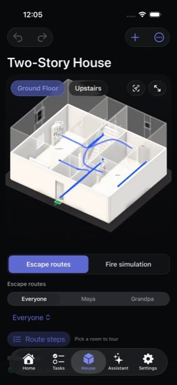
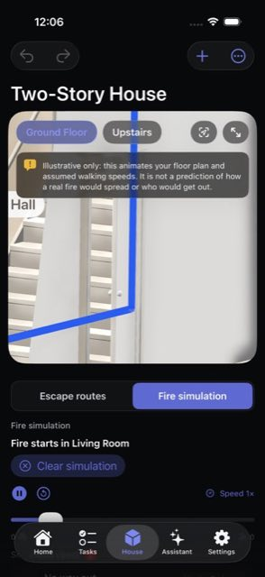
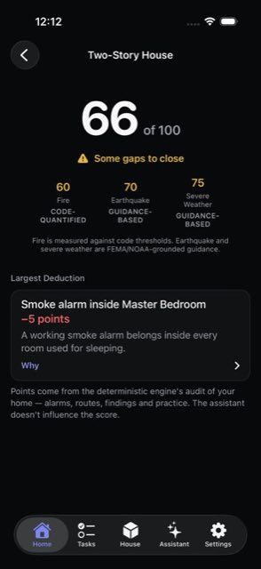
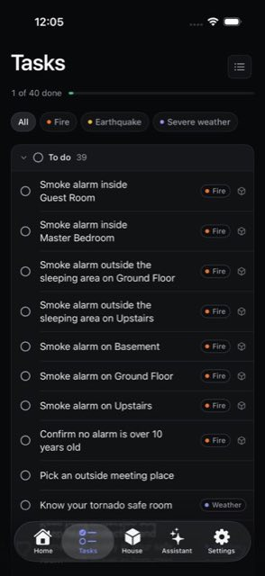
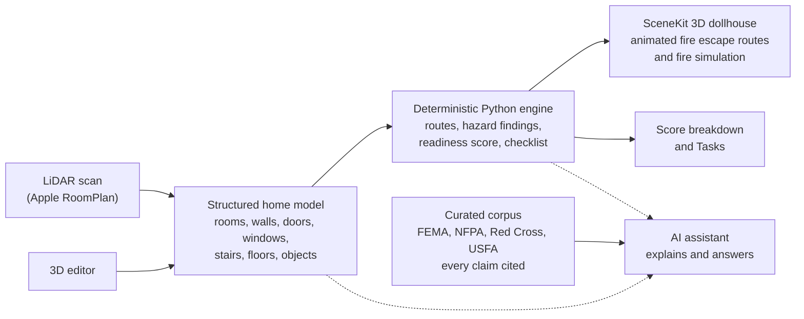

# Escape Plan

**Map your home once. Know every way out.**

Escape Plan is an iOS app that helps a family build, check and practise a home escape plan before an emergency
happens. It turns your real home into a 3D model, finds a main and, where one exists, a backup fire escape route out of every
room for each person who lives there, and turns what it finds into a readiness score and a checklist for **fire, earthquake and severe weather
(tornado)**.

Built for the 2026 Congressional App Challenge.

<p align="center">
  
  
  
  
</p>

## Why it matters

In a home fire you may have as little as two minutes to get out after the smoke alarm sounds, yet the American Red
Cross reports that only about 26% of families have made and practised a home fire escape plan. A plan sketched on
paper is easy to put off, and it cannot answer the questions that matter: is the bedroom window big enough to climb
out of? Can Grandpa use the stairs? What if the fire starts in the kitchen?

Escape Plan answers those questions from the shape of your actual home, and keeps the answer current when the home
changes.

## Features

- **Capture your home in 3D.** Scan it room by room with Apple RoomPlan on a LiDAR iPhone, or build it by hand. Four
  ready-made homes are there to explore on first launch: three sample homes and Anish's House.
- **A full 3D editor.** Add and edit rooms, doors, windows, stairs, floors and objects, with undo and redo. Doors and
  windows are attached to their walls, so moving a wall moves them too and the routes update.
- **Escape routes for every person.** A deterministic routing engine finds a main and, where one exists, a backup
  route out of every room. Household profiles for a child, an older relative or someone who cannot use stairs each get
  a route that fits them, and pets join the household too. A room with no way out is flagged.
- **Fire simulation.** Start a fire in any room and watch everyone's route change around it, in an illustrative
  animation on a 3D dollhouse of your home with play, pause, replay and speed controls.
- **A readiness score you can read.** One score out of 100, with a sub-score for each hazard and the largest
  deduction explained. Fire is measured against code thresholds such as egress window size; earthquake and severe
  weather are labelled as guidance-based and built from FEMA, NOAA and USGS guidance.
- **A Tasks checklist.** Concrete steps, from smoke alarms to a tornado safe room, each showing its source where it
  has one. Filter by fire, earthquake or severe weather and tick items off as you go.
- **A grounded assistant.** Built to answer questions about your own home using only a curated library of 35 sources
  from FEMA, NFPA, the American Red Cross, USFA, NOAA, USGS and others.
- **A printable plan.** Export a PDF escape plan for the fridge door, designed to stay readable in greyscale.
- **Share with your fire department.** An opt-in snapshot of your floor plan, exits, utility shutoffs and who may need
  help. Occupant names stay out unless you turn them on, and nothing is sent without your say-so, every time.
- **Works offline where it counts.** The last routes the app received for a home stay on screen without a
  connection.
- **Accessible.** Dynamic Type, VoiceOver labels, 44-point touch targets, and safety colours chosen to stay distinct
  for colour-blind users.

## How it works



1. **One home model.** A scan or the editor produces a structured model of the home: room outlines on each floor,
   with doors and windows placed along their walls. Every part of the system reads the same model, defined by one
   JSON Schema (`schema/homemodel.schema.json`).
2. **A deterministic engine.** A Python engine turns the home into a graph of rooms, doors, windows and stairs and
   runs a shortest-path search from every room, adjusted for each person. Same home in, same routes out, every time.
   The same engine produces the hazard findings, the 0 to 100 readiness score and the checklist.
3. **A 3D dollhouse.** The app draws the home in SceneKit and animates the fire escape routes through it.
   Earthquake and severe weather readiness appear in the score breakdown and the Tasks checklist.
4. **An assistant that explains, never decides.** The assistant answers questions about your home using the
   engine's results and a curated library of FEMA, NFPA, Red Cross and USFA guidance. The server checks every source
   tag against that library and only lets safety advice through when it cites a real source. It is built to tell
   anyone in danger right now to get out and call 911 first.

**The AI never computes a route and never invents safety guidance.** Routes, scores and findings come from the
engine; safety guidance comes from the cited corpus. The AI explains them in plain words, and can sketch a draft
floor plan from a description or photo (Import Plan) that you check and confirm in the editor. That
separation is what makes Escape Plan more than an AI wrapper: the parts that must be right are code you can test.

## How to use it

1. **Open a home.** Tap the home name at the top of the **Home** tab to pick a sample home, or tap **+** to scan a new
   home, build one by hand, or import a plan.
2. **See the 3D house.** Open the **House** tab. Your home appears as a 3D dollhouse with the fire escape routes
   drawn from every room. Switch floors, choose who is escaping (everyone, or one person), then tap a room and tap
   **Route steps** to walk its route stop by stop.
3. **Run the fire simulation.** Switch to **Fire simulation**, choose the room where the fire starts, and watch the
   routes change around it.
4. **Read your score.** On the **Home** tab, tap the preparedness score to open the breakdown: a sub-score for fire,
   earthquake and severe weather, and the largest deduction, with the reason why.
5. **Work through Tasks.** The **Tasks** tab lists what to do next, from smoke alarms to a tornado safe room. Filter by
   hazard, open a task to see its source, and tick it off.
6. **Ask the assistant.** The **Assistant** tab is built to answer questions about your home from the cited library;
   the server rejects safety advice that has no source.
7. **Share with your fire department.** From **Tasks** or **Settings**, create the opt-in snapshot, review exactly what
   it includes, and send it with AirDrop, Messages or Files. To print the plan as a PDF, open **Tasks**, scroll to
   **Family plan** and tap **Outside meeting point**.

Escape Plan is a prevention and readiness app. It helps families prepare before an emergency; the fire department
snapshot is something a family chooses to share in advance.

## Get started

You need a Mac with Xcode 26 and Python 3.11 or newer (we use 3.12). The 3D editor, the sample homes, routes, the fire
simulation, the score and Tasks all run in the iOS Simulator. No Apple developer account is needed for the Simulator.
Scanning a real home needs an iPhone or iPad with LiDAR.

### 1. Run the backend

The `python3` that ships with macOS is 3.9, which is too old. If `python3 --version` shows anything below 3.11,
install Python 3.12 (from python.org, or `brew install python@3.12`) and use `python3.12` in the venv line below.

```bash
cd backend
python3 -m venv .venv && source .venv/bin/activate      # or: python3.12 -m venv .venv
pip install -r requirements.txt
export BACKEND_BEARER_TOKEN=<an access token you choose>
uvicorn app.main:app --reload --port 8000
```

| Variable | Purpose |
|---|---|
| `BACKEND_BEARER_TOKEN` | Required. The access token the app sends with each request. |
| `ANTHROPIC_API_KEY` | Optional. Enables the assistant and Import Plan. Routes, the score and Tasks do not use it. |

Interactive API docs are then at `http://localhost:8000/docs`. More endpoints and examples:
[`backend/README.md`](backend/README.md).

### 2. Run the app

1. Open `escape_plan.xcodeproj` in Xcode.
2. Choose any iPhone simulator on iOS 17 or newer and press **Run**. Simulator builds sign locally, so you do not
   need our team's account; if Xcode shows a signing-team message, choose your own team or None.
3. Finish or skip the first-run tour. Open **Settings**, tap **Use local dev server (localhost:8000)**, enter the
   same access token under **Access token**, and tap **Save changes**. (These settings appear in builds run from
   Xcode.) If you started the backend on another port, type `http://localhost:<port>` under **Server address**
   before saving. **Test connection** should then show **Connected**.
4. Tap the home name at the top of **Home**, pick a sample home, and open the **House** tab.

To build from the command line instead of Xcode:

```bash
xcodebuild build -project escape_plan.xcodeproj -scheme escape_plan \
  -destination 'platform=iOS Simulator,name=iPhone 17 Pro' CODE_SIGNING_ALLOWED=NO
```

### Run the tests

From the repo root:

```bash
backend/.venv/bin/pip install -r backend/requirements-dev.txt    # test tools, once
python3 backend/corpus/validate.py                               # every citation resolves
backend/.venv/bin/python -m pytest backend/tests/ -m "not live"  # engine, scoring, API
swift test --package-path tools/editorcore                       # editor and model logic, no simulator
xcodebuild test -project escape_plan.xcodeproj -scheme escape_plan \
  -destination 'platform=iOS Simulator,name=iPhone 17 Pro' CODE_SIGNING_ALLOWED=NO
```

## Tech stack

| Layer | Technology |
|---|---|
| iOS app | Swift, SwiftUI, iOS 17+ |
| 3D | SceneKit, generated entirely from the home model (no 3D asset files) |
| Scanning | Apple RoomPlan on LiDAR devices |
| Engine and server | Python 3.11+, FastAPI, pydantic v2 |
| Shared contract | JSON Schema (draft 2020-12), mirrored by pydantic models and Swift Codable types |
| Assistant | Anthropic Claude, grounded in a cited corpus with server-side citation checks |
| Hosting and CI | Render, GitHub Actions |

The iOS app uses Apple frameworks only, with no third-party packages. Every library, service and AI tool is listed
in [`docs/tools-used.md`](docs/tools-used.md).

## Project structure

| Path | What is there |
|---|---|
| `escape_plan/` | The iOS app: screens, 3D renderer, editor, scanning, export and sharing |
| `escape_planTests/`, `escape_planUITests/` | iOS unit and UI tests |
| `backend/app/routing/` | The deterministic routing engine, fire simulation and object hazard rules |
| `backend/app/scoring/` | The readiness score, hazard findings and checklist |
| `backend/app/convert/` | RoomPlan scan to home model converter |
| `backend/app/ai/` | The grounded assistant and its citation checks |
| `backend/corpus/` | The curated safety library and `sources.json` |
| `schema/` | The home model JSON Schema and sample homes |
| `tools/editorcore/` | A Swift package that tests the app's pure logic on macOS in seconds |
| `docs/` | Product spec, design notes, decisions log and submission materials |

## Credits

Built by the Escape Plan team for the 2026 Congressional App Challenge. Thanks to the working firefighter whose
feedback shaped Escape Plan into a prevention and readiness app for families. Safety guidance is our own paraphrase
of public material from FEMA, NFPA, the American Red Cross, USFA, NOAA, USGS and others, each cited in
[`backend/corpus/sources.json`](backend/corpus/sources.json); those organisations do not endorse this app.

Copyright (c) 2026 the Escape Plan team. See [`LICENSE`](LICENSE).
